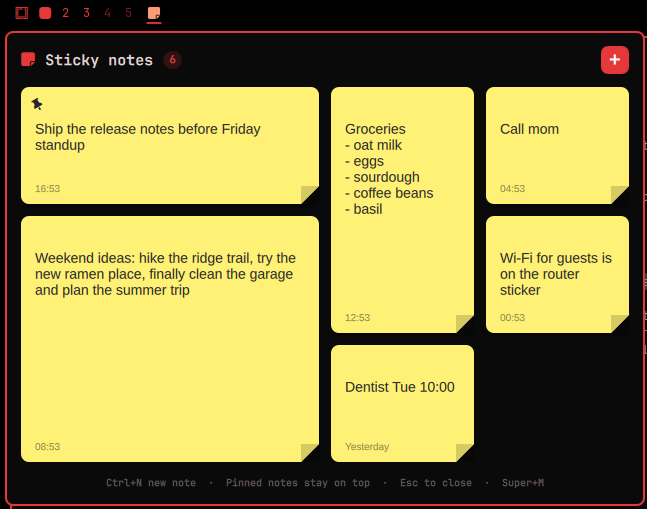

# Omarchy Sticky Notes

[](LICENSE)
[](https://omarchy.org/)
[](https://doc.qt.io/qt-6/qtquick-index.html)
[](https://quickshell.org/)
[](https://hypr.land/)
[](https://github.com/RuffBudda/omarchy-sticky-notes/commits/main)

A sticky notes plugin for the [Omarchy](https://omarchy.org/) shell. A bar icon
opens a panel of yellow sticky notes laid out as a bento board. Notes live only
in the panel, never on the desktop.



## Features

- **Bar icon** opens and closes the panel. Middle-click it for a quick new note.
- **Bento board**: notes come in four sizes (small, wide, tall, large) and pack
  together. New notes start large.
- **Type right away**: a new note gets the cursor as soon as it is created.
- **Hover a note** for three buttons:
  - **Pin**: pinned notes stay at the top.
  - **Resize**: cycles small → wide → tall → large.
  - **Delete**: the trash icon turns red; click again within 3 seconds to delete.
    Empty notes delete on the first click.
- **View all**: the panel shows 6 notes; *View all* widens it to every note.
- **Keys in the panel**: `Ctrl+N` new note, `Esc` close.
- **Saved automatically** to `~/.local/share/omarchy-sticky-notes/notes.json`, and kept
  in sync across monitors. Only your account can read them: the folder is `0700` and
  the file `0600`, whatever your umask (older installs are tightened on first start).
- Panel colors follow your Omarchy theme.

## Requirements

- Omarchy with the Quickshell-based shell (`omarchy plugin` commands available).
- A Nerd Font for the icons (Omarchy's default JetBrainsMono Nerd Font works).

**External dependencies: none.** The plugin is a single QML file that uses only
what the Omarchy shell already provides. It runs no network requests and no
privileged commands. The only process it starts is a short `sh` command on first
start that creates its notes folder (`0700`) and `notes.json` (`0600`), and tightens
them if an older version left them readable to others.
It never edits your Omarchy, Hyprland or bar configuration.

## Install

```bash
omarchy plugin add https://github.com/RuffBudda/omarchy-sticky-notes.git --enable
```

The icon goes on the left of the bar. To move it:

```bash
omarchy bar move io.github.ruffbudda.sticky-notes --section right
```

If the icon doesn't appear, restart the shell:

```bash
omarchy restart shell
```

### Optional: keyboard shortcut

Add this to `~/.config/hypr/bindings.lua` to open and close the panel with Super+M
(check first that Super+M isn't already bound on your system):

```lua
o.bind("SUPER + M", "Sticky notes", "omarchy-shell stickynotes toggle")
```

Then reload Hyprland with `hyprctl reload`.

## Commands

The plugin listens on the `stickynotes` IPC target:

```bash
omarchy-shell stickynotes toggle   # open / close the panel
omarchy-shell stickynotes open     # open the panel
omarchy-shell stickynotes all      # open in "View all" mode
omarchy-shell stickynotes add      # add a note and open the panel
```

## Update and uninstall

```bash
omarchy plugin update io.github.ruffbudda.sticky-notes
omarchy plugin remove io.github.ruffbudda.sticky-notes
```

Removing the plugin keeps your notes. Delete
`~/.local/share/omarchy-sticky-notes/` to remove them as well.

## License

[MIT](LICENSE)
